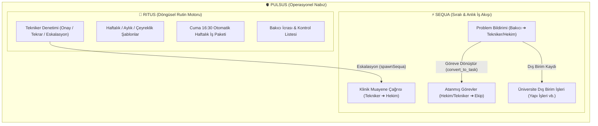

# Pulsus - Vizyon ve Blueprint

> *"Laboratuvarda ritim aksarsa bilim durur; sıra şaşarsa biyogüvenlik kırılır."*  
> **Pulsus**, deney hayvanları uygulama ve araştırma merkezlerinin (İMU DEHAL) kesintisiz operasyonel nabzını tutan; periyodik rutinleri (**Ritus**) ve dinamik iş akışlarını (**Sequa**) tek bir denetim, izin ve eskalasyon omurgasında birleştiren kurumsal görev yönetim platformudur.

---

## 🌟 1. Ürün Vizyonu ve Çift Motorlu (Dual-Engine) Felsefe

Deney hayvanları laboratuvarlarında işler iki temel düzlemde yürür:
1. **Asla Aksamaması Gereken Periyodik Rutinler (Ritus):** Kafes ve altlık değişimleri, sabah yem ve suluk kontrolleri, otoklav Bowie-Dick testleri, koridor dezenfeksiyonları, aylık SKT denetimleri ve çeyreklik FELASA sentinel taramaları.
2. **Anlık Gelişen Olaylar, Klinik Talepler ve Arızalar (Sequa):** Kafes değişimi sırasında fark edilen hasta bir hayvan için veteriner hekim çağrısı, yıkama odasında tıkanan gider bildirimi veya üniversite Yapı İşleri Daire Başkanlığı ile takip edilen HEPA filtre / HVAC arızaları.

Geleneksel görev yazılımları (Trello, Jira, Asana) bu iki dünyayı aynı kefeye koyar ve laboratuvar hiyerarşisini, vardiya/izin devirlerini veya "Bakıcı Yapar -> Tekniker Denetler -> Veteriner Hekime Eskale Edilir" döngüsünü anlayamaz.

**Pulsus**, adını Latince *"nabız / ritmik vuruş"* kavramından alır ve birbirini besleyen iki alt motordan oluşur:

---

## 👥 2. 5 Kişilik Laboratuvar Hiyerarşisi ve Operasyonel Rol Kuralları

Pulsus, laboratuvarın gerçek saha organizasyonuna birebir uyumlu **3 katmanlı rol mimarisi** üzerinde çalışır:

| Rol Kodu | Kurumsal Ünvan | Laboratuvar Personeli | Temel Yetki ve Sorumluluk Alanı |
| :--- | :--- | :--- | :--- |
| **`vet`** | **Sorumlu Veteriner Hekim** | • **Oğuzhan Baygül** | • **Tam Yetki:** Ritus rutin şablonlarını oluşturabilen, güncelleyebilen ve silebilen **tek** roldür. • Tüm personele görev atayabilir, üniversite dış birim (`external`) işlerini açabilir. • Hem asil hem yedek personel izinliyken görevlerin son güvenlik ağıdır (`vet_fallback`). |
| **`technician`** | **Veteriner Sağlık / Lab. Teknikeri** | • **Kübra Çelik** • **Gamze Demir** | • **Denetçi ve Saha Koordinatörü:** Bakıcıların tamamladığı Ritus rutinlerini denetler; onaylar (`approve`), eksikse gerekçeli tekrar ister (`request_revision`) veya Veteriner Hekime sevk eder (`escalate_to_vet`). • Bakıcılara ve diğer teknikere görev (`task`) atayabilir. • Kafes/hayvan başında acil klinik durumlarda Veteriner Hekime muayene çağrısı (`vet_request`) açabilir. |
| **`caretaker`** | **Hayvan Bakıcısı / Temizlik Görevlisi** | • **Gökhan Sert** • **Yusuf Enes Işık** *(+ Onur Yeşilyurt)* | • **Saha İcra Gücü:** Kendilerine (veya yedek olarak) atanan Ritus rutinlerini ve Sequa görevlerini kontrol listesiyle birlikte yerine getirir ve denetime sunar (`submit_for_review`). • **Yatay/Aşağı Görev Atayamaz:** Başka bir bakıcıya görev atayamaz veya rutin şablonu değiştiremez. • **Yukarı Yönlü Bildirim Hakkı:** Sahada gördüğü aksaklıkları Teknikere veya Veteriner Hekime **Problem Bildirimi (`issue_report`)** olarak iletir. |

---

## 🗓️ 3. Ritus Zamanlama Kuralları ve Cuma 16:30 Dağıtım Mimarisi

### 3.1 Cuma 16:30 Otomatik Haftalık Paket Dağıtımı
Laboratuvar ekibinin Pazartesi sabahı sürprizle karşılaşmaması ve hafta sonu nöbet/izin planlamasının netleşmesi için:
- **Her Cuma saat 16:30** itibarıyla (`isFridayDistributionTimeReached`), Ritus motoru bir sonraki haftanın (`W+1`, Pazartesi..Pazar) iş paketini tüm aktif şablonları tarayarak otomatik ve **idempotent** (mükerrer kayıt üretmeden) dağıtır.
- Cuma 16:30 öncesinde gelecek haftanın paketi erken açılmaz; yalnızca mevcut hafta (`W`) aktif tutulur.

### 3.2 Hafta Ortası Ay ve Çeyrek Geçiş Kuralı (Mid-Week Transition)
Bir hafta Pazartesi günü başlar ve Pazar günü biter; ancak yeni bir ay veya çeyrek **haftanın tam ortasında** (örneğin Çarşamba günü ayın 1'i veya 11'i olduğunda) başlayabilir.
- Ritus dağıtım motoru (`doesTemplateMatchDay`), haftanın 7 gününü (`Monday..Sunday`) tek tek takvim günü, ay (`1..12`), ayın günü (`1..31`) ve ayın son günü (`28/29/30/31`) bazında analiz eder.
- Haftanın ortasına denk gelen **Aylık (`monthly`)** ve **Çeyreklik (`quarterly`)** şablonlar hiç atlanmadan o haftanın Cuma 16:30 iş paketine otomatik dahil edilir.

### 3.3 Şablon Güncelleme Kapsamı (`updateScope`)
Sorumlu Veteriner Hekim bir Ritus şablonunda saat, kontrol listesi veya sorumlu değişikliği yaptığında sistem iki açık seçenek sunar:
1. **`next_week` (Gelecek Haftadan İtibaren Geçerli Olsun):** Mevcut haftanın dağıtılmış görev kartlarına dokunulmaz; değişiklik Cuma 16:30'da dağıtılacak yeni haftadan itibaren uygulanır.
2. **`current_week` (Bu Haftanın Görevlerine de Yansıt):** Mevcut haftadaki henüz tamamlanmamış (`todo`, `in_progress`, `needs_revision`) görev kartları anında yeni şablon verisiyle ve güncel izin durumuyla senkronize edilir (`syncTemplateToCurrentWeekRuns`).

---

## 🔄 4. Circa İzin Entegrasyonu ve 3 Kademeli Yedek (Backup) Devir Zinciri

Pulsus, **Circa** (`Circa_db.time_offs`) veritabanı ile canlı entegrasyon içinde çalışır. Bir görev dağıtılırken veya gün içinde `todo` durumundayken hem **Sorumlu (`Assignee`)** hem de **Denetçi (`Reviewer`)** için 3 kademeli kesintisiz devir zinciri işletilir:

$$\text{1. Asil Sorumlu (Primary)} \xrightarrow{\text{İzinliyse}} \text{2. Yedek Sorumlu (Backup)} \xrightarrow{\text{Yedek Yok / İzinliyse}} \text{3. Sorumlu Veteriner Hekim (Vet Fallback)}$$

1. **Günlük ve Saatlik İzin Hassasiyeti:**
   - Circa'da onaylanmış (`status: 'approved'`) tam gün (`unit: 'daily'`) izinler o günkü tüm görevleri kapsar.
   - Saatlik (`unit: 'hourly'`) izinlerde ise görevin planlanan saati (`scheduledTime`, örn. `09:30`) izin aralığı (`startTime <= scheduledTime <= endTime`) içindeyse yedek personel otomatik devreye girer.
2. **Sıfır Sahipsiz Görev Garantisi (`vet_fallback`):**
   - Hem asil personel hem de yedeği aynı gün izinliyse (veya yedek tanımlanmamışsa), görev asla sahipsiz kalmaz; otomatik olarak **Sorumlu Veteriner Hekime (`oguzhan.baygul@medeniyet.edu.tr`)** düşer ve kart üzerinde kırmızı **`vet_fallback`** uyarısı gösterilir.
   - Veteriner Hekim bu görevi bizzat yürütebilir veya `vet_reassign` aksiyonu ile o gün uygun olan başka bir personele atayabilir.
3. **Kendi Kendini Denetleme Koruması (Self-Review Guard):**
   - İzin devirleri sonucunda `effectiveAssignee` ile `effectiveReviewer` aynı kişi olursa (Veteriner Hekim hariç), sistem denetçiyi otomatik olarak bir üst yedeğe veya Veteriner Hekime kaydırır.

---

## 🔍 5. Denetim (Review), Tekrarlatma (`needs_revision`) ve Ritus -> Sequa Köprüsü

1. **Denetim Zorunluluğu:** Bakıcılar hiçbir görevi doğrudan `done` (Tamamlandı) durumuna getiremez. Kontrol listesini tamamlayıp **Denetime Gönder (`submit_for_review`)** aksiyonunu tetiklerler (`status: 'pending_review'`).
2. **Tekrarlatma / Revizyon (`request_revision`):** Denetçi (Tekniker), sahada eksiklik tespit ederse (örneğin *"Suluklar eksik kontrol edilmiş, tekrar yapılacak"*) zorunlu denetim notuyla görevi geri çevirir. Görev durumu `'needs_revision'` olur, `revisionCount` 1 artar ve personel performans raporlarına işlenir.
3. **Ritus -> Sequa Eskalasyon Köprüsü (`escalate_to_vet`):** Rutin bir görev sırasında rutin dışı klinik veya teknik bir kriz çıktığında Tekniker görevi Veteriner Hekime sevk eder. `spawnSequa: true` seçildiğinde Ritus görevi `'escalated'` durumuna geçerken **Sequa** üzerinde bağlı bir `vet_request` görevi (`sourceRitusRunId` ve `spawnedSequaIds` ile çift yönlü bağlı) otomatik olarak açılır.

---

## 🗺️ 6. Yol Haritası

- **Faz 1 — Çift Motorlu Çekirdek & Circa İzin Köprüsü (Tamamlandı ✅):** Ritus şablon/dağıtım motoru, Cuma 16:30 kuralı, hafta ortası ay/çeyrek geçişleri, Circa 3 kademeli yedek zinciri, Sequa kanban iş akışı ve performans raporlama.
- **Faz 2 — Locus & Silo Çapraz Otomasyon (Planlanıyor 📋):** Kafes değişimi rutinleri tamamlandığında Silo'dan otomatik altlık/yem stok düşümü ve Locus oda/kafes kartlarında son temizlik zaman damgasının gösterimi.
- **Faz 3 — Mobil Barkod / QR Doğrulama (Gelecek Vizyon 🚀):** Oda kapılarındaki QR kodların okutularak yerinde denetim zaman damgası oluşturulması.
