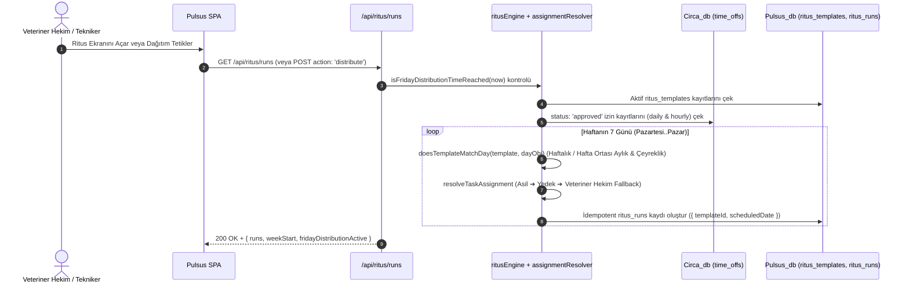
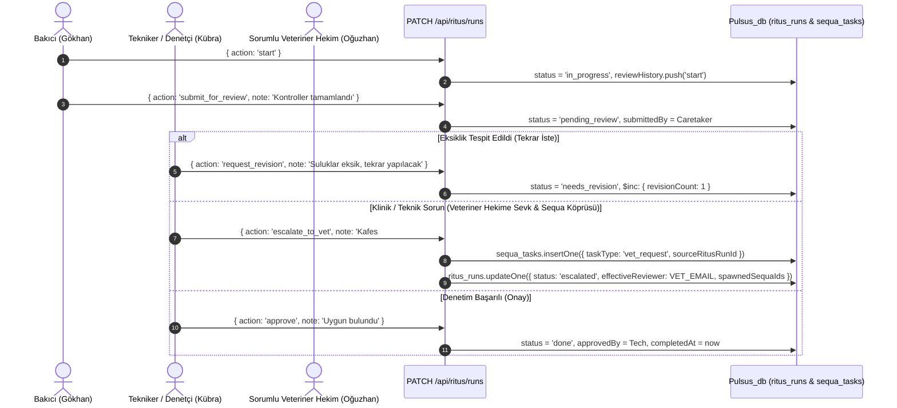
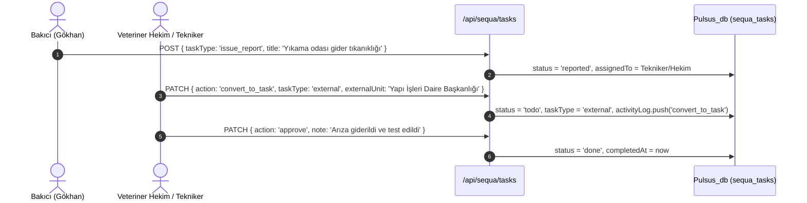

# Pulsus - Teknik Dokümantasyon

Bu doküman, **Pulsus** (Ritus & Sequa) laboratuvar rutin ve iş akışı yönetim sisteminin teknik mimarisini, zamanlama ve izin çözümleme algoritmalarını, veritabanı şemalarını ve Serverless API spesifikasyonlarını ayrıntılandırmaktadır.

---

## 🏗️ 1. Mimari Genel Bakış ve Akış Diyagramları

Pulsus; **Apex Hub** (`Apex_db.users`) üzerinden merkezi SSO kimlik doğrulaması yapan, **Circa** (`Circa_db.time_offs`) üzerinden canlı personel izin verilerini okuyan ve kendi operasyonel verilerini **`Pulsus_db`** (`members`, `ritus_templates`, `ritus_runs`, `sequa_tasks`) üzerinde yöneten sunucusuz (Vercel Serverless + React 19 SPA) bir uygulamadır.

### 1.1 Ritus Cuma 16:30 Dağıtımı ve Circa İzin Devir Akışı

### 1.2 Bakıcı İcrası, Tekniker Denetimi, Tekrarlatma (`needs_revision`) ve Eskalasyon (`escalated`)

### 1.3 Sequa Yukarı Yönlü Bildirim ve Göreve Dönüştürme Akışı

---

## 🛡️ 2. Ortam İzolasyonu (`Pulsus_db` vs `Pulsus_test_db`)

`lib/mongodb.js` içerisindeki dinamik çözümleyiciler sayesinde canlı veritabanı ile test/önizleme ortamları birbirinden tamamen izole edilmiştir:

- **`isProdEnv()`:** Yalnızca `process.env.VERCEL_ENV === 'production'` veya `process.env.FORCE_PROD_DB === 'true'` olduğunda `true` döner.
- **`getDbName(baseName)`:**
  - Canlı ortamda: `Pulsus_db`, `Circa_db`, `Apex_db`
  - Test / Preview / Geliştirme ortamında: `Pulsus_test_db`, `Circa_test_db`, `Apex_test_db`
- **`getSessionCookieName()`:**
  - Canlı ortamda: `interapp_session`
  - Test / Preview / Geliştirme ortamında: `interapp_session_test`

---

## 🗄️ 3. Veritabanı Şema Spesifikasyonu (`Pulsus_db`)

### 3.1 `members` Koleksiyonu (Laboratuvar Ekibi ve Yedek Yapılandırması)
| Alan Adı | Tip | Zorunlu | Açıklama |
| :--- | :--- | :---: | :--- |
| `_id` | `ObjectId` | Evet | Benzersiz kayıt kimliği |
| `email` | `String` | Evet | Kurumsal e-posta adresi (küçük harf normalize) |
| `name` | `String` | Evet | Personelin adı soyadı |
| `pulsusRole` | `String` | Evet | `'vet'` \| `'technician'` \| `'caretaker'` |
| `title` | `String` | Evet | Kurumsal ünvan (örn. `'Sorumlu Veteriner Hekim'`) |
| `defaultBackupEmail`| `String \| null`| Hayır | Personel izinliyken devreye girecek varsayılan yedek e-postası |
| `isActive` | `Boolean` | Evet | Aktif personel durumu |

### 3.2 `ritus_templates` Koleksiyonu (Rutin Görev Şablonları)
| Alan Adı | Tip | Zorunlu | Açıklama |
| :--- | :--- | :---: | :--- |
| `_id` | `ObjectId` | Evet | Şablon kimliği |
| `title` | `String` | Evet | Rutin görev başlığı (`2..150` karakter) |
| `description` | `String` | Hayır | Görev uygulama açıklaması |
| `category` | `String` | Evet | `'cleaning'` \| `'feeding'` \| `'health'` \| `'calibration'` \| `'biosecurity'` \| `'admin'` \| `'other'` |
| `frequency` | `String` | Evet | `'weekly'` \| `'monthly'` \| `'quarterly'` |
| `daysOfWeek` | `Array<Number>` | Hayır | Haftalık görevler için gün indeksleri (`1=Pazartesi .. 7=Pazar`) |
| `dayOfMonth` | `Number \| null`| Hayır | Aylık/Çeyreklik görevler için ayın günü (`1..31`, ay sonu taşma korumalı) |
| `monthsOfQuarter`| `Array<Number>` | Hayır | Çeyreklik görevlerin çalışacağı aylar (varsayılan: `[1, 4, 7, 10]`) |
| `scheduledTime` | `String` | Evet | Planlanan saat (`HH:MM` 24-saat formatı, örn. `'08:30'`) |
| `primaryAssignee`| `String` | Evet | Asil sorumlu e-postası |
| `backupAssignee` | `String \| null`| Hayır | Yedek sorumlu e-postası |
| `primaryReviewer`| `String` | Evet | Asil denetçi e-postası |
| `backupReviewer` | `String \| null`| Hayır | Yedek denetçi e-postası |
| `checklist` | `Array<String>` | Hayır | Alt kontrol maddeleri dizisi |
| `contextRef` | `Object \| null`| Hayır | `{ module, entityType, entityId, label }` (Locus/Silo referansı) |
| `isActive` | `Boolean` | Evet | Şablonun aktiflik durumu |

### 3.3 `ritus_runs` Koleksiyonu (Haftalık Dağıtılmış Rutin Görev Kartları)
| Alan Adı | Tip | Açıklama |
| :--- | :--- | :--- |
| `_id` | `ObjectId` | Görev kartı kimliği |
| `templateId` | `String` | Kaynak `ritus_templates._id` referansı |
| `weekStart` | `String` | Ait olduğu haftanın Pazartesi tarihi (`YYYY-MM-DD`) |
| `scheduledDate` | `String` | Görevin yapılacağı takvim günü (`YYYY-MM-DD`) |
| `scheduledTime` | `String` | Planlanan saat (`HH:MM`) |
| `primaryAssignee` / `backupAssignee` | `String` | Şablondan gelen asil ve yedek sorumlu |
| `effectiveAssignee` | `String` | Circa izin kontrolü sonrası aktif sorumlu e-postası |
| `assignmentStatus` | `String` | `'primary'` \| `'backup'` \| `'vet_fallback'` \| `'reassigned_by_vet'` |
| `delegatedFrom` | `String \| null` | İzin nedeniyle devredildiyse izinli asil personelin e-postası |
| `vetFallback` | `Boolean` | Asil ve yedek izinli olduğu için Veteriner Hekime düştüyse `true` |
| `effectiveReviewer` | `String` | Circa izin kontrolü sonrası aktif denetçi e-postası |
| `reviewerStatus` | `String` | `'primary'` \| `'backup'` \| `'vet_fallback'` \| `'reassigned_by_vet'` |
| `status` | `String` | `'todo'` \| `'in_progress'` \| `'pending_review'` \| `'needs_revision'` \| `'escalated'` \| `'done'` |
| `checklist` | `Array<Object>` | `[{ id: Number, text: String, done: Boolean }]` |
| `revisionCount` | `Number` | Denetçi tarafından kaç kez tekrarlatıldığı (`request_revision` sayacı) |
| `lastRevisionNote` | `String \| null` | Son tekrarlatma gerekçesi |
| `escalationNote` | `String \| null` | Veteriner Hekime eskalasyon gerekçesi |
| `spawnedSequaIds` | `Array<String>` | Eskalasyon ile oluşturulan `sequa_tasks` ID listesi |
| `reviewHistory` | `Array<Object>` | `[{ action, by, byName, at, note }]` denetim izi |

### 3.4 `sequa_tasks` Koleksiyonu (Dinamik İş Akışı, Bildirim ve Dış Birim Kayıtları)
| Alan Adı | Tip | Açıklama |
| :--- | :--- | :--- |
| `_id` | `ObjectId` | Görev kimliği |
| `title` | `String` | Görev veya bildirim başlığı |
| `description` | `String` | Detaylı açıklama |
| `taskType` | `String` | `'task'` (Görev) \| `'vet_request'` (Hekim Çağrısı) \| `'issue_report'` (Problem Bildirimi) \| `'external'` (Üniversite Dış Birim) |
| `priority` | `String` | `'low'` \| `'medium'` \| `'high'` \| `'critical'` |
| `status` | `String` | `'reported'` \| `'todo'` \| `'in_progress'` \| `'review'` \| `'done'` |
| `createdBy` / `createdByRole` | `String` | Kaydı açan personel ve rolü |
| `assignedTo` / `assignedToRole`| `String` | Atanan aktif sorumlu (Circa izin devri uygulanmış) |
| `reviewerEmail` | `String` | Görevi onaylayacak denetçi/hekim e-postası |
| `externalUnit` | `String \| null` | Dış birim adı (örn. `'Yapı İşleri Daire Başkanlığı'`) |
| `externalTicketNo` | `String \| null` | Kurum içi EBYS / arıza takip numarası |
| `sourceRitusRunId` | `String \| null` | Ritus eskalasyonundan doğduysa kaynak `ritus_runs._id` |
| `revisionCount` | `Number` | Revizyon sayacı |
| `activityLog` | `Array<Object>` | Tüm durum geçişlerinin ve notların tarihçesi |

---

## 🔌 4. Kapsamlı API Referansı

Tüm uç noktalar `verifyUser(req)` ile `interapp_session` (veya test ortamında `interapp_session_test`) çerezini ve kullanıcının `apps` dizisinde `'pulsus'` yetkisini zorunlu kılar. Tüm mutasyon gövdeleri **Zod v4** ile doğrulanır.

### 4.1 `GET / DELETE / POST /api/auth/session`
- **`GET`**: `{ email, name, role, apps, pulsusRole, title }` döner. Oturumsuzsa `401`, `pulsus` yetkisi yoksa `403` döner.
- **`DELETE` / `POST`**: Oturum çerezini `Max-Age=0` ile temizler.

### 4.2 `GET / POST / PUT /api/members`
- **`GET /api/members?date=YYYY-MM-DD`**: 5 kişilik laboratuvar ekibini, `Circa_db.time_offs` üzerindeki onaylı günlük/saatlik izin durumlarıyla (`onLeaveToday`, `todayLeaveInfo`, `upcomingLeaves`) zenginleştirerek döner.
- **`POST / PUT /api/members`**: Yalnızca `pulsusRole === 'vet'` yetkisine açıktır (diğer roller `403` alır). Personelin rolünü ve varsayılan yedeğini (`defaultBackupEmail`) günceller.

### 4.3 `GET / POST / PUT / DELETE /api/ritus/templates`
- **`GET`**: Tüm rutin görev şablonlarını listeler.
- **`POST` / `PUT` / `DELETE`**: Yalnızca **Sorumlu Veteriner Hekim (`vet`)** tarafından çağrılabilir (`technician` ve `caretaker` için `403 Forbidden` döner).
- **`updateScope` Parametresi (`'next_week'` \| `'current_week'`):**
  - `'next_week'`: Sadece şablonu günceller; mevcut haftanın dağıtılmış `ritus_runs` kayıtları değişmez.
  - `'current_week'`: `syncTemplateToCurrentWeekRuns` tetiklenerek mevcut haftadaki tamamlanmamış görevler anında güncellenir.

### 4.4 `GET / POST / PATCH /api/ritus/runs`
- **`GET /api/ritus/runs?weekStart=YYYY-MM-DD`**:
  - İlgili haftanın görevlerini döner ve `todo` durumundaki görevleri en güncel Circa izinleriyle senkronize eder.
  - Cuma 16:30 geçildiyse (`isFridayDistributionTimeReached`), gelecek haftanın (`W+1`) paketini otomatik dağıtır.
- **`POST /api/ritus/runs`**:
  - `action: 'distribute'`: Hedef haftanın görev paketini idempotent olarak dağıtır (`caretaker` için `403`).
  - `action: 'sync_leaves'`: Circa izinlerini yeniden tarayarak `todo` görevlerin yedek/hekim devirlerini günceller.
- **`PATCH /api/ritus/runs`**:
  - `action: 'start'`: Görevi `'in_progress'` durumuna alır.
  - `action: 'toggle_checklist'`: Kontrol listesi maddelerini işaretler.
  - `action: 'submit_for_review'`: Görevi `'pending_review'` durumuna alır.
  - `action: 'approve'`: Denetçi veya Veteriner Hekim görevi onaylar (`'done'`). Bakıcı çağırırsa `403` döner.
  - `action: 'request_revision'`: Denetçi zorunlu `note` ile görevi tekrarlatır (`status: 'needs_revision'`, `revisionCount += 1`).
  - `action: 'escalate_to_vet'`: Görevi Veteriner Hekime sevk eder (`status: 'escalated'`). `spawnSequa: true` ise otomatik `sequa_tasks` kaydı açar.
  - `action: 'vet_reassign'`: Sorumlu Veteriner Hekim görevi başka bir personele atar (`reassignedByVet: true`).

### 4.5 `GET / POST / PATCH /api/sequa/tasks`
- **`GET /api/sequa/tasks`**: Filtrelenebilir (`taskType`, `status`, `assignedTo`, `sourceRitusRunId`) Sequa görev listesini döner.
- **`POST /api/sequa/tasks`**:
  - `caretaker` yalnızca Teknikere veya Veteriner Hekime yönelik `taskType: 'issue_report'` açabilir; `task` veya `external` açmaya çalışırsa ya da başka bir bakıcıya atama yaparsa `403 Forbidden` alır.
  - `technician` bakıcılara/teknikere `task` atayabilir ve Veteriner Hekime `vet_request` açabilir.
  - `vet` tüm görev türlerini (`task`, `vet_request`, `issue_report`, `external`) oluşturabilir.
- **`PATCH /api/sequa/tasks`**:
  - `action: 'convert_to_task'`: Bakıcının açtığı `issue_report` bildirimini atanmış göreve (`task`) veya dış birim işine (`external`) dönüştürür.
  - `action: 'request_revision'`: Görevi revizyon notuyla `'in_progress'` durumuna geri çeker ve `revisionCount` değerini artırır.
  - `action: 'approve'`: Görevi onaylayıp `'done'` durumuna kapatır (`caretaker` için `403`).
  - `action: 'reassign'` / `'move_status'` / `'add_note'`: Sorumlu değişikliği, sütun taşıma ve aktivite notu ekleme.

### 4.6 `GET /api/reports`
- Laboratuvar genel özetini (`summary`), personel bazlı tamamlama, tekrarlatılma (`totalRevisionsReceived`), eskalasyon (`escalatedCount`), izin devri (`delegatedOutByLeave`, `delegatedInAsBackup`) metriklerini (`staffMetrics`), son tekrarlatılan/eskale edilen görevleri (`recentRevisionsAndEscalations`) ve üniversite dış birim işlerini (`externalTasks`) döner.
